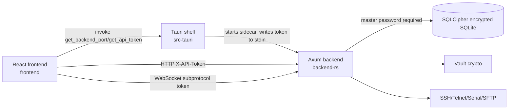

# Architecture

Netrix is a local desktop app split into three cooperating parts: Tauri shell, React frontend, and Rust backend sidecar.

## Component Diagram

## Runtime Components

Netrix runs as a local desktop application with three components:

1. Tauri shell (`src-tauri`) written in Rust.
2. React frontend (`frontend`) written in TypeScript.
3. Rust backend sidecar (`backend-rs`) written with Axum and Tokio.

The Tauri shell starts the backend sidecar on a random localhost port and generates a per-session API token. The frontend gets the active port and token via Tauri commands and communicates directly with the backend over HTTP and WebSocket.

## Tauri Shell

`src-tauri/src/main.rs` finds a free localhost port, generates a UUID API token, starts the backend sidecar, and exposes `get_backend_port`, `get_api_token`, and `get_backend_status` commands. The status contract is `{ status: "starting" | "ready" | "failed", message?: string }`; readiness is reached only after an authenticated `GET /health` returns HTTP 200. In development Tauri launches `backend-rs/target/debug/netrix_backend.exe`; in production it launches the bundled sidecar through `tauri-plugin-shell`.

On Windows, a Job Object is used to group and terminate the backend with the main app. Tauri resolves `%APPDATA%/com.netrix.app`, migrates non-conflicting entries from the legacy `%APPDATA%/Netrix` directory, and passes the resolved path to the backend through `NETRIX_DATA_DIR`. Production shell logs use the same identifier-based directory.

## Frontend

The frontend is a Vite React app. The primary state container is `frontend/src/state/store.ts`. It stores hosts, tabs, renderer/socket mirrors used by the UI, settings, SFTP state, vault state, network-map state, groups, toasts, and recent connections.

The UI is composed from feature components in `frontend/src/components/`. `terminal/TerminalSessionController.ts` owns terminal transport, heartbeat, reconnect, session metadata, and bounded replay while `TerminalCanvas.tsx` owns the active xterm renderer. SFTP browsing is in `SftpBrowser.tsx`, settings in `Settings.tsx`, utilities in `UtilitiesHub.tsx`, and network topology is split between `NetworkMap.tsx` and pure helpers under `features/network-map/`.

## Backend Services

The backend is an Axum server bound to `127.0.0.1`. `backend-rs/src/main.rs` configures CORS, process lifecycle and the authenticated startup gate. `startup.rs` exposes only health, security status and password entry until the master password opens the encrypted database. It then creates vault/session/SFTP state and publishes the protected routes assembled in `application.rs`. The frontend keeps workspace content unmounted before this first unlock.

Major backend domains:

- `routers/health.rs`: authenticated readiness response used by the Tauri shell.
- `routers/hosts.rs`: host CRUD and credential attachment.
- `routers/sessions.rs`: terminal WebSocket endpoints.
- `routers/vault.rs`: vault unlock, lock, reset, password rotation, status, and item access.
- `routers/sftp.rs`: SFTP capability, probe, list, streaming transfer jobs, safe upload, cancellation and file mutations.
- `routers/network_tools.rs`: TCP scan and TLS inspection.
- `routers/network_map.rs`: map sheets, nodes, edges, duplicate, auto-populate, ping.
- `routers/snippets.rs`: command snippets and remote snippet execution.
- `routers/quick_actions.rs`: command shortcut CRUD.
- `routers/highlighting.rs`: terminal highlight rule CRUD.
- `routers/recent_connections.rs`: recent host usage.
- `routers/logs.rs`: audit log listing.
- `ssh/manager.rs`: SSH/Telnet/Serial sessions, detach, reattach, resize, cleanup, circuit breaker.
- `ssh/sftp.rs`: standalone SFTP v3 client.
- `ssh/telnet.rs`: minimal Telnet negotiation over TCP.
- `vault.rs`: Argon2id key derivation and AES-256-GCM encryption.
- `db.rs`: SQLite pool type and embedded schema migrations.
- `database_encryption.rs`: SQLCipher pool, wrapped database key, verified plaintext conversion and password-rotation recovery.
- `startup.rs` / `application.rs`: password gate and protected router composition.

## Protocol Support

Implemented connection protocols:

- SSH
- Telnet
- Serial

Protocol validation is enforced in host CRUD and quick-connect paths. Optional capabilities are tracked separately from connection protocols. SFTP is modeled as an SSH-only capability with cached states such as `unknown`, `supported`, `unsupported`, `auth_failed`, and `error`.

## Data Flow

### HTTP

HTTP handles CRUD and bounded file/network operations: hosts, snippets, vault actions, network map, logs, quick actions, highlighting, recent connections, SFTP capability/list/download/upload, and network tools.

### WebSocket

WebSocket handles interactive terminal traffic:

- `/ws/terminal/{host_id}` for saved hosts.
- `/ws/quick-connect?ticket=...` for one-off ephemeral sessions. The ticket is created first through authenticated HTTP at `/sessions/quick-connect-tickets`.

Each WebSocket session receives structured control messages (`progress`, `connect`, `error`, `disconnect`) and raw terminal payload. `TerminalSessionController` consumes `__JSON__` control messages, keeps the transport alive without a mounted renderer, and replays at most 2 MiB when the active renderer attaches.

## Session Lifecycle

1. Frontend creates a one-time quick-connect ticket when using ephemeral credentials, then opens a WebSocket with terminal size, terminal type, timeout, keepalive, and token subprotocol.
2. Backend resolves host configuration and credentials, using the vault when `credential_id` is present.
3. Session manager connects the protocol transport: SSH, Telnet, or Serial.
4. Backend streams terminal output through broadcast channels.
5. On detach, a live transport is preserved and can be reattached.
6. On close or terminate, session manager performs protocol-specific cleanup.

## SFTP Files Lifecycle

1. Frontend opens the Files workflow for an SSH host.
2. Backend reads unexpired cached `host_capabilities` state.
3. For a probe or operation, `SftpManager` leases an isolated SFTP connection from a bounded pool, with a deadline covering authentication and subsystem negotiation.
4. Directory listing initializes SFTP v3, resolves the requested path, opens the directory, reads entries, maps file metadata, and closes the handle.
5. File preview/download initializes SFTP v3, resolves the requested path, opens the file read-only, reads bounded chunks, closes the handle, and returns bytes through authenticated HTTP.
6. Upload streams to an exclusive sibling temporary file, checks FSTAT/fsync/CLOSE and commits by rename. Replacing a regular file requires explicit confirmation and atomic-rename support.
7. Capability status is stored in SQLite.
8. Existing terminal sessions are not reused or closed by SFTP operations.
9. Terminal SSH and SFTP SSH connections share the same in-process known-hosts store and on-disk `known_hosts` file.

SFTP jobs provide real progress and cancellation; Files also supports mkdir, rename, file/empty-directory delete and chmod. Folder recursion, synchronization and restart-resume are not implemented. See [SFTP implementation](SFTP_IMPLEMENTATION.md) for limits, cleanup and lifecycle details.

## Persistence

The SQLCipher-encrypted SQLite database lives in the app data directory. All tables and WAL payloads are encrypted; SQLite temporary storage stays in memory. A random database key is wrapped by the master password in `.database-key`, so an explicit password is required at every app start. The existing vault retains its own inner encryption.

- Schema is managed through versioned SQL migrations in `backend-rs/migrations`.
- Runtime migration state is tracked in `_migrations`.
- WAL mode is enabled for better concurrent behavior.
- Existing plaintext databases are exported, fully compared with the source and backed up in encrypted form before atomic replacement. Preserve `database.db`, `.database-key` and `.vault_salt` together for recovery; see [database storage](DATABASE_STRUCTURE.md).

## Security Boundaries

- Backend listens on `127.0.0.1` only.
- API token auth is required for HTTP and WebSocket endpoints.
- HTTP uses `X-API-Token`; WebSocket uses token-bearing subprotocol transport.
- Quick-connect credentials stay in authenticated HTTP request bodies and in-memory tickets, not WebSocket URLs.
- Vault keys are never persisted in plaintext and are zeroized on lock/drop.
- Restart protection covers SQLite metadata as well as credentials. A running application lock leaves the database pool and keys in RAM; closing Netrix releases them. Old plaintext backups, UI preferences, diagnostic logs, exports and known-host files are outside SQLite encryption.
- Vault unlock atomically migrates legacy plaintext host credentials into encrypted vault items before publishing the in-memory key; runtime transports never fall back to the legacy columns.
- SQLite `secure_delete`, a post-migration `VACUUM`, and a truncating WAL checkpoint remove legacy plaintext remnants visible at the SQLite file layer on a best-effort basis.
- Vault unlock has an in-memory failed-attempt limiter before expensive key verification.
- Host key verification behavior is configurable via `SSH_KNOWN_HOSTS_POLICY` and defaults to strict TOFU. Terminal and SFTP connections share host-key trust state.
- Tauri CSP blocks `unsafe-eval`, production builds omit the devtools feature, and no shell commands are exposed to webviews.
- App-command ACL and label-specific capabilities keep window creation/keychain access in `main`, clipboard access in `main` and `detached-*`, and a smaller event/window surface in `map-*`. `tab-preview-*` windows receive no IPC capability.

## Packaging and Deployment

- Development: `npm run tauri dev` plus debug backend sidecar.
- Production: frontend build plus release backend sidecar bundled into one NSIS installer by Tauri.
- Backend sidecar is managed by Tauri process lifecycle and terminated when the parent exits.

## Strong Parts

- Clear runtime separation between shell, UI, and backend sidecar.
- Localhost binding, per-session token auth, and restricted CORS are built in.
- Saved credentials are separated from host DTOs through vault-backed `credential_id` plus `has_password`/`has_private_key` flags.
- SQLite migrations are versioned and embedded in the backend binary.
- SSH host key verification uses TOFU by default with mismatch rejection, shared between Terminal and SFTP paths.
- SFTP operations are isolated from interactive terminal sessions.
- Quick-connect tickets and vault unlock rate limiting cover two high-risk credential paths.
- Backend uses parameterized SQLx queries throughout normal request paths.

## Weak Parts and Risks

- Large frontend coordination files increase regression risk.
- Frontend has focused API, readiness, store, terminal-controller, and network-map unit tests plus a Windows desktop startup smoke test; broad component interaction coverage is still limited.
- Migration registration is explicit; a unit test guards against registry/directory drift.
- Some routers have limited validation compared with host/network-tool handlers.
- Sensitive mutation endpoints beyond vault unlock do not all have dedicated rate limits.
- CSP still allows inline styles, and Tauri desktop permissions should stay under review before a hardened release.
- SFTP implementation is custom protocol code and needs careful bounds/interop testing.
- Session manager handles multiple protocols, retries, circuit breaking, detach, and cleanup in one large module.

## Refactor Priorities

1. Split frontend store domains into smaller slices or helper modules without changing behavior.
2. Extend focused session and network-map coverage to SFTP manager behavior and broader component interactions.
3. Add broader upgrade tests for future schema migrations and historical database snapshots.
4. Tighten router validation for snippets, quick actions, highlighting, map node/edge dimensions, and recent connection limits.
5. Continue tightening Tauri CSP and permissions before wider platform release.

## Scaling Strategy

- Keep the app local-first and sidecar-based.
- Add feature domains as separate routers plus focused frontend components.
- Keep protocol-specific transport code behind `SessionManager` and `SftpManager` boundaries.
- Add API contract tests before large frontend refactors.
- Add background job abstractions only when SFTP transfer queues or long-running network tasks require them.
